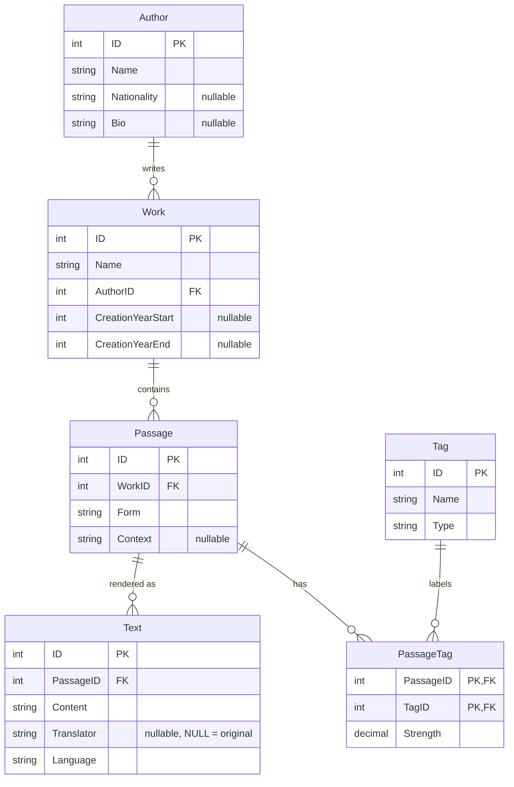

# 02 Data model

Status: v1.0 schema and MVP schema defined. Relational database, designed schema-first.
This document is the source of truth for database design (see D-012 in `decisions.md`).

The database engine is not chosen yet. The constraints only use portable features: CHECK constraints,
foreign key actions and filtered unique indexes. Both PostgreSQL and SQL Server support all of them.

## Conventions
- Every entity has a surrogate primary key `ID`. The one exception is PassageTag, which uses the composite key `(PassageID, TagID)`.
- Columns are NOT NULL by default. A column is nullable only when "unknown" or "not applicable" is a valid value.
- A text column that is NOT NULL must also be non-blank (it cannot be only whitespace).
- Language codes follow ISO 639. `und` (undetermined) is used when the language is unknown.
- Years are integers. Negative years are BCE. There is no year 0, so 1 BCE is directly followed by 1 CE.

## Entities (v1.0)

### Author
A person credited with one or more Works.

| Column | Null | Constraints |
|---|---|---|
| ID | no | PK |
| Name | no | Non-blank. Not unique, because different authors can share a name. |
| Nationality | yes | NULL when unknown, or not applicable (ancient or stateless authors). |
| Bio | yes | |

Seed data: one Author with Name `Anonymous`. Every anonymous Work points to this row, so `Work.AuthorID` stays NOT NULL.

### Work
The whole work a Passage is taken from.

| Column | Null | Constraints |
|---|---|---|
| ID | no | PK |
| Name | no | Non-blank. UNIQUE (AuthorID, Name). |
| AuthorID | no | FK → Author.ID, ON DELETE RESTRICT. |
| CreationYearStart | yes | Integer, ≠ 0. Earliest possible year of creation. NULL = no known lower bound. |
| CreationYearEnd | yes | Integer, ≠ 0. Latest possible year of creation. NULL = no known upper bound. |

Table rule: CHECK (CreationYearStart <= CreationYearEnd) when both are set.
- An exact year is stored with Start = End.
- An unknown date is stored with both NULL.

### Passage
An excerpt from a Work. A Passage is the unit the reader sees.

| Column | Null | Constraints |
|---|---|---|
| ID | no | PK |
| WorkID | no | FK → Work.ID, ON DELETE RESTRICT. Indexed. |
| Form | no | CHECK IN a fixed list. Starting set: `verse`, `prose`, `drama`. The final list is open (D-011). |
| Context | yes | NULL when not applicable, for example when the passage stands on its own. |

### Text
The wording of a Passage in one language: either the original or a translation.

| Column | Null | Constraints |
|---|---|---|
| ID | no | PK |
| PassageID | no | FK → Passage.ID, ON DELETE CASCADE. Indexed. |
| Content | no | Non-blank. |
| Translator | yes | NULL means this Text is the original. A translation by an unknown translator stores `Unknown`. Non-blank when set. |
| Language | no | ISO 639 code. CHECK on the format. `und` = undetermined. |

Table rules:
- Filtered UNIQUE (PassageID) WHERE Translator IS NULL. A Passage has at most one original.
- UNIQUE (PassageID, Language, Translator).

### Tag
A theme, motif, emotion or ambiance that passages can be labelled with. Tags are kept in one table, and the kind is stored in `Type`.

| Column | Null | Constraints |
|---|---|---|
| ID | no | PK |
| Name | no | Non-blank. UNIQUE (Type, Name). |
| Type | no | CHECK IN (`theme`, `motif`, `emotion`, `ambiance`). |

### PassageTag
Links a Passage to a Tag, with a weight saying how strongly the tag applies.

| Column | Null | Constraints |
|---|---|---|
| PassageID | no | PK part. FK → Passage.ID, ON DELETE CASCADE. |
| TagID | no | PK part. FK → Tag.ID, ON DELETE CASCADE. Indexed, for "passages by tag". |
| Strength | no | DECIMAL(3,2). CHECK (Strength > 0 AND Strength <= 1). A value of 0 would mean "no link", so it is excluded. |

## Relationships
| From | To | Cardinality | On delete |
|---|---|---|---|
| Author | Work | one Author has zero or many Works; each Work has exactly one Author | RESTRICT |
| Work | Passage | one Work has zero or many Passages; each Passage has exactly one Work | RESTRICT |
| Passage | Text | one Passage has zero or many Texts; each Text belongs to exactly one Passage | CASCADE |
| Passage | Tag | many-to-many through PassageTag | CASCADE (on PassageTag rows) |

Every relationship rule above is enforced with keys and CHECK constraints. No rules are left for the application to enforce.

## Connections
Connections between passages are a **planned system**. They are not part of the MVP or v1.0 schema, and neither schema has a table for them.
In the MVP, readers find related passages with a tag browser instead: they pick a Tag and see its Passages through PassageTag.
How connections will work is an open question (D-010).

## MVP schema
The MVP has the same six tables and constraints as v1.0, with one difference. **Work is thin**: it has only `ID`, `Name` and `AuthorID`.

| Table | MVP difference |
|---|---|
| Author | none |
| Work | `CreationYearStart` and `CreationYearEnd` and their CHECKs are left out |
| Passage | none |
| Text | none |
| Tag | none |
| PassageTag | none |

The MVP is a strict subset of v1.0. Upgrading is purely additive: add the two nullable year columns and their CHECKs. No data needs to be migrated.

## Deliberately left out
- **Passage connections**: planned, not in the MVP or v1.0 (see Connections).
- **Work creation years**: left out of the MVP, added in v1.0.
- **Work original language**: removed (D-007).

## Open questions
- How do connections between passages work? Are they typed (similar theme, same motif, contrast) or plain links? Are they derived from shared tags or stored? (D-010)
- What is the final list of `Passage.Form` values? (D-011)
