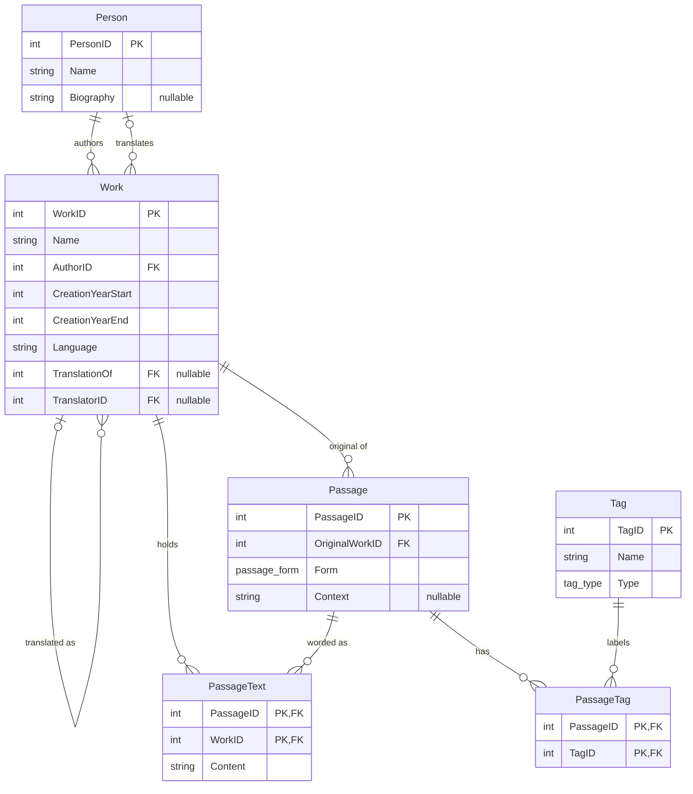

# 02 Data model

Status: v1.0 schema, revision 2 (D-019). PostgreSQL database accessed through EF Core, designed schema-first (D-007).
This document is the source of truth for database design (D-018).

## Conventions
- Each entity has a surrogate primary key named `<Entity>ID`, generated as an identity column.
  The link tables PassageText and PassageTag use composite keys.
- Every column is required (NOT NULL) unless it is marked nullable.
- A required text column must also be non-blank (not only whitespace).
- Years are integers. Negative years are BCE and positive years are CE. There is no year 0.
- A Work with a known year of creation has the same value in CreationYearStart and CreationYearEnd.
  If the year is unknown, an estimated range is stored (D-022).
- Language codes follow ISO 639. `und` (undetermined) is used when the language is unknown.
- Enumerations (`Passage.Form`, `Tag.Type`) are PostgreSQL enum types (D-025).
- Unknown authors and translators point to the sentinel Person row `unknown` (D-027).

## Entities

### Person
A person credited as the author or the translator of a Work.

| Column | Null | Constraints |
|---|---|---|
| PersonID | no | PK |
| Name | no | Non-blank. Not unique, because different people can share a name. |
| Biography | yes | |

Seed data: one sentinel row with Name `unknown`. It is used both for unknown authors and for unknown translators (D-027).

### Work
A complete work, either an original or a translation. A translation is its own Work, linked to the Work it was translated from.

| Column | Null | Constraints |
|---|---|---|
| WorkID | no | PK |
| Name | no | Non-blank. |
| AuthorID | no | FK → Person, ON DELETE RESTRICT. Indexed. |
| CreationYearStart | no | ≠ 0. For a translation, the years the translation was made (D-029). |
| CreationYearEnd | no | ≠ 0. |
| Language | no | ISO 639 code (CHECK: 2 or 3 lowercase letters). The language of this Work itself (D-024). |
| TranslationOf | yes | FK → Work, ON DELETE RESTRICT. Indexed. CHECK TranslationOf <> WorkID. NULL means this Work is an original. |
| TranslatorID | yes | FK → Person, ON DELETE RESTRICT. Indexed. |

Table rules:
- CHECK (CreationYearStart <= CreationYearEnd).
- CHECK ((TranslationOf IS NULL) = (TranslatorID IS NULL)):
  - An original has no translator.
  - A translation always has a translator. If the translator is unknown, it is the `unknown` Person row.
- UNIQUE NULLS NOT DISTINCT (AuthorID, Name, Language, TranslatorID).
- A translation may itself be translated. Relay translations are allowed (D-023).

### Passage
An excerpt, independent of any single wording. Its wordings are stored in PassageText, one per Work.

| Column | Null | Constraints |
|---|---|---|
| PassageID | no | PK |
| OriginalWorkID | no | FK → Work, ON DELETE RESTRICT. Indexed. The original Work the passage comes from (D-028). |
| Form | no | Enum `passage_form`: `verse`, `prose`, `drama`. The final list is open (D-017). |
| Context | yes | |

A Passage may have no PassageText (D-030).

### PassageText
The wording of a Passage as it appears in one Work: the original or a translation.

| Column | Null | Constraints |
|---|---|---|
| PassageID | no | PK part. FK → Passage, ON DELETE CASCADE. |
| WorkID | no | PK part. FK → Work, ON DELETE RESTRICT. Indexed. |
| Content | no | Non-blank. |

### Tag
A theme, motif, emotion or ambiance that passages can be labelled with.

| Column | Null | Constraints |
|---|---|---|
| TagID | no | PK |
| Name | no | Non-blank. UNIQUE (Type, Name). |
| Type | no | Enum `tag_type`: `theme`, `motif`, `emotion`, `ambiance`. |

### PassageTag
Links a Passage to a Tag.

| Column | Null | Constraints |
|---|---|---|
| PassageID | no | PK part. FK → Passage, ON DELETE CASCADE. |
| TagID | no | PK part. FK → Tag, ON DELETE CASCADE. Indexed, for "passages by tag". |

## Relationships
| From | To | Cardinality | On delete |
|---|---|---|---|
| Person | Work (author) | a Person authors zero or many Works; each Work has exactly one author | RESTRICT |
| Person | Work (translator) | a Person translates zero or many Works; each Work has zero or one translator | RESTRICT |
| Work | Work (translation) | a Work has zero or many translations; each Work translates zero or one Work | RESTRICT |
| Work | Passage | an original Work has zero or many Passages; each Passage has exactly one original Work | RESTRICT |
| Passage | Work | many-to-many through PassageText; a Passage has zero or many PassageTexts | CASCADE from Passage, RESTRICT from Work |
| Passage | Tag | many-to-many through PassageTag | CASCADE |

## Backend rules
These rules compare several rows, so CHECK constraints can't express them. The backend and the content loader enforce them.
1. A translation's `AuthorID` equals the `AuthorID` of the Work it translates.
2. `TranslationOf` chains must not loop (A → B → A).
3. `Passage.OriginalWorkID` points to an original, meaning a Work whose `TranslationOf` is NULL.
4. Each PassageText's Work is either the Passage's `OriginalWorkID` or a translation whose `TranslationOf` chain leads back to it.

## Connections
Connections between passages are a **planned system**. They are not part of the schema.
In the MVP, readers find related passages with a tag browser instead: they pick a Tag and see its Passages through PassageTag (D-015).
How connections will work is an open question (D-016).

## MVP schema
The MVP schema will be derived from this revision (D-026).

## Open questions
- How do connections between passages work? Are they typed or plain links? Are they derived from shared tags or stored? (D-016)
- What is the final list of `Passage.Form` values? (D-017)
- Which parts of this schema are in the MVP? (D-026)
