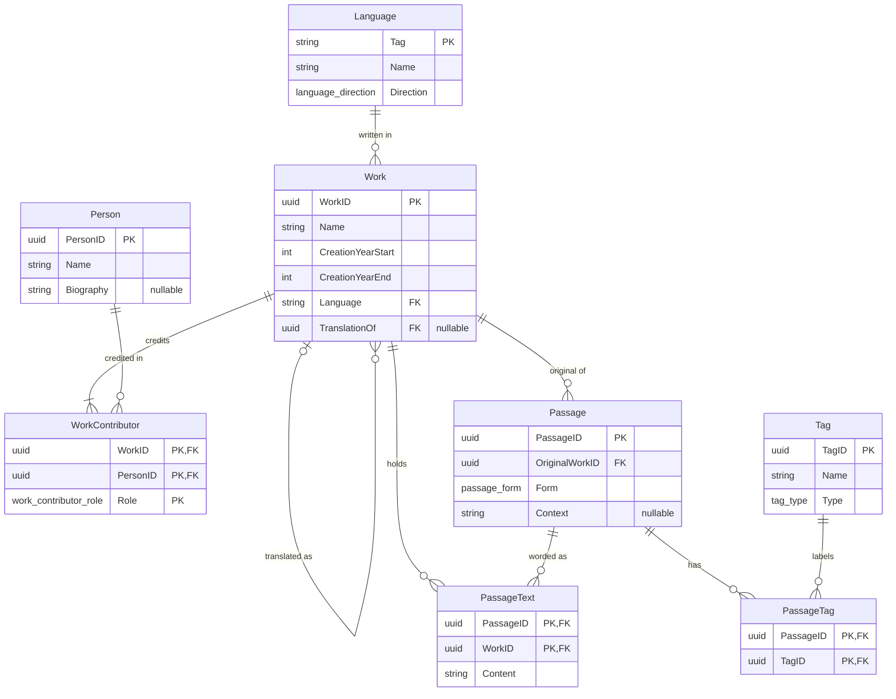

# 02 Data model

Status: v1.0 schema, revision 3 (D-040). PostgreSQL database accessed through EF Core, designed schema-first (D-007).
This document is the source of truth for database design (D-018).

## Conventions
- Each entity has a surrogate primary key named `<Entity>ID`. Keys are UUIDs, version 7 (`Guid.CreateVersion7()`) (D-043).
  The link tables PassageText, PassageTag and WorkContributor use composite keys made of those UUIDs. WorkContributor's key also includes `Role`.
  The exception is Language, which is keyed by its BCP 47 tag (D-032).
- One database is the source of truth for catalog data. After launch, that is production. Other databases are created from dumps of it and never create rows of their own (D-043, D-045).
- The backend creates UUIDs with `Guid.CreateVersion7()` when it inserts a row. The database never generates them, so key columns have no default (D-043).
- A row's UUID never changes once it has been created (D-043), and stays the same across databases unless exceptions apply (D-045).
- The exception to backend-created UUIDs is the `unknown` Person, whose GUID is hardcoded in the backend (D-044).
- Languages are added by the seeding process like the rest of the catalog (D-040, D-043).
- Every column is required (NOT NULL) unless it is marked nullable.
- A required text column must also be non-blank (not only whitespace).
- Years are integers. Negative years are BCE and positive years are CE. There is no year 0.
- A Work with a known year of creation has the same value in CreationYearStart and CreationYearEnd.
  If the year is unknown, an estimated range is stored (D-022).
- Language tags follow BCP 47, in the shortest correct form (D-033).
- Enumerations (`Passage.Form`, `Tag.Type`, `Language.Direction`, `WorkContributor.Role`) are PostgreSQL enum types (D-025).
- Unknown authors and translators point to the sentinel Person row `unknown` (D-041).
- Contributors are shown sorted by name (D-040).

## Entities

### Person
A person credited as an author or a translator of a Work, through WorkContributor.

| Column | Null | Constraints |
|---|---|---|
| PersonID | no | PK, UUID. |
| Name | no | Non-blank. Not unique, because different people can share a name. |
| Biography | yes | |

The seeding process creates one sentinel row with Name `unknown` and the GUID hardcoded in the backend (D-044). It is used both for unknown authors and for unknown translators (D-041).

### Language
A language, keyed by its BCP 47 tag (D-032).

| Column | Null | Constraints |
|---|---|---|
| Tag | no | PK. BCP 47 tag in shortest correct form (D-033). CHECK `Tag ~ '^[a-z]{2,3}(-[A-Z][a-z]{3})?(-([A-Z]{2}\|[0-9]{3}))?$'`. |
| Name | no | Non-blank. |
| Direction | no | Enum `language_direction`: `ltr`, `rtl`, describing how letters run along a line. Vertical text is out of scope. |

### Work
A complete work, either an original or a translation. A translation is its own Work, linked to the Work it was translated from.

| Column | Null | Constraints |
|---|---|---|
| WorkID | no | PK, UUID. |
| Name | no | Non-blank. |
| CreationYearStart | no | ≠ 0. For a translation, the years the translation was made (D-029). |
| CreationYearEnd | no | ≠ 0. |
| Language | no | FK → Language.Tag, ON DELETE RESTRICT. Indexed. The language of this Work itself (D-024, D-032). |
| TranslationOf | yes | UUID, FK → Work, ON DELETE RESTRICT. Indexed. CHECK TranslationOf <> WorkID. NULL means this Work is an original. |

Table rules:
- CHECK (CreationYearStart <= CreationYearEnd).
- A translation may itself be translated. Relay translations are allowed (D-023).

Authors and translators are in WorkContributor. Duplicate Works are handled by the seeding process (D-042).

### WorkContributor
Credits a Person as an author or a translator of a Work (D-040). A Work can have several authors and several translators (D-039).

| Column | Null | Constraints |
|---|---|---|
| WorkID | no | PK part. UUID, FK → Work, ON DELETE CASCADE. |
| PersonID | no | PK part. UUID, FK → Person, ON DELETE RESTRICT. Indexed. |
| Role | no | PK part. Enum `work_contributor_role`: `author`, `translator`. |

### Passage
An excerpt, independent of any single wording. Its wordings are stored in PassageText, one per Work.

| Column | Null | Constraints |
|---|---|---|
| PassageID | no | PK, UUID. |
| OriginalWorkID | no | UUID, FK → Work, ON DELETE RESTRICT. Indexed. The original Work the passage comes from (D-028). |
| Form | no | Enum `passage_form`: `verse`, `prose`, `drama`. The final list is open (D-017). |
| Context | yes | |

A Passage may have no PassageText (D-030).

### PassageText
The wording of a Passage as it appears in one Work: the original or a translation.

| Column | Null | Constraints |
|---|---|---|
| PassageID | no | PK part. UUID, FK → Passage, ON DELETE CASCADE. |
| WorkID | no | PK part. UUID, FK → Work, ON DELETE RESTRICT. Indexed. |
| Content | no | Non-blank. |

The format of `Content` is drafted in `08-passage-text-format.md` (D-034). `Content` stays a text column until it is decided.

### Tag
A theme, motif, emotion or ambiance that passages can be labelled with.

| Column | Null | Constraints |
|---|---|---|
| TagID | no | PK, UUID. |
| Name | no | Non-blank. UNIQUE (Type, Name). |
| Type | no | Enum `tag_type`: `theme`, `motif`, `emotion`, `ambiance`. |

### PassageTag
Links a Passage to a Tag.

| Column | Null | Constraints |
|---|---|---|
| PassageID | no | PK part. UUID, FK → Passage, ON DELETE CASCADE. |
| TagID | no | PK part. UUID, FK → Tag, ON DELETE CASCADE. Indexed, for "passages by tag". |

## Relationships
| From | To | Cardinality | On delete |
|---|---|---|---|
| Language | Work | a Language has zero or many Works; each Work has exactly one Language | RESTRICT |
| Person | Work | many-to-many through WorkContributor; each Work has at least one author row | CASCADE from Work, RESTRICT from Person |
| Work | Work (translation) | a Work has zero or many translations; each Work translates zero or one Work | RESTRICT |
| Work | Passage | an original Work has zero or many Passages; each Passage has exactly one original Work | RESTRICT |
| Passage | Work | many-to-many through PassageText; a Passage has zero or many PassageTexts | CASCADE from Passage, RESTRICT from Work |
| Passage | Tag | many-to-many through PassageTag | CASCADE |

## Backend rules
These rules compare several rows, so CHECK constraints can't express them. The backend and the content loader enforce them.
1. A translation's author rows are copied from the Work it was translated from.
2. `TranslationOf` chains must not loop (A → B → A).
3. `Passage.OriginalWorkID` points to an original, meaning a Work whose `TranslationOf` is NULL.
4. Each PassageText's Work is either the Passage's `OriginalWorkID` or a translation whose `TranslationOf` chain leads back to it.
5. Every `lang` value in a PassageText's text JSON exists in `Language` (D-032).
6. Every Work has at least one author row (D-040).
7. Translator rows exist only on Works with `TranslationOf` set (D-040).
8. Every translation has at least one translator row. If the translator isn't known, the row points to the `unknown` Person.
   A translation with no translator rows is an error, caught when the backend creates it and by the validation queries after seeding (D-041).

## Connections
Connections between passages are a **planned system**. They are not part of the schema.
In the MVP, readers find related passages with a tag browser instead: they pick a Tag and see its Passages through PassageTag (D-015).
How connections will work is an open question (D-016).

## MVP schema
The MVP schema will be derived from this revision (D-026).

## Open questions
- How do connections between passages work? Are they typed or plain links? Are they derived from shared tags or stored? (D-016)
- What is the final list of `Passage.Form` values? (D-017)
- Which parts of this schema are in the MVP? (D-026)
- Which format does `PassageText.Content` use? The draft is a JSON document in `jsonb`, see `08-passage-text-format.md` (D-034).
